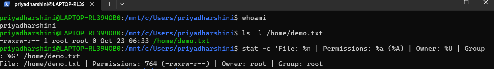

# Linux File Permissions Task

## Environment
Ubuntu on WSL 2.

## Task
Create /home/demo.txt with permissions 764 (-rwxrw-r--).

- Owner: read, write, execute.
- Group: read, write.
- Others: read only.

## Run
Run: bash setup-permissions.sh

## Verify
Run: ls -l /home/demo.txt
Expected permissions: -rwxrw-r-- (764).

Git does not preserve all Linux permissions. Run the script to reproduce the result.

## Screenshot

